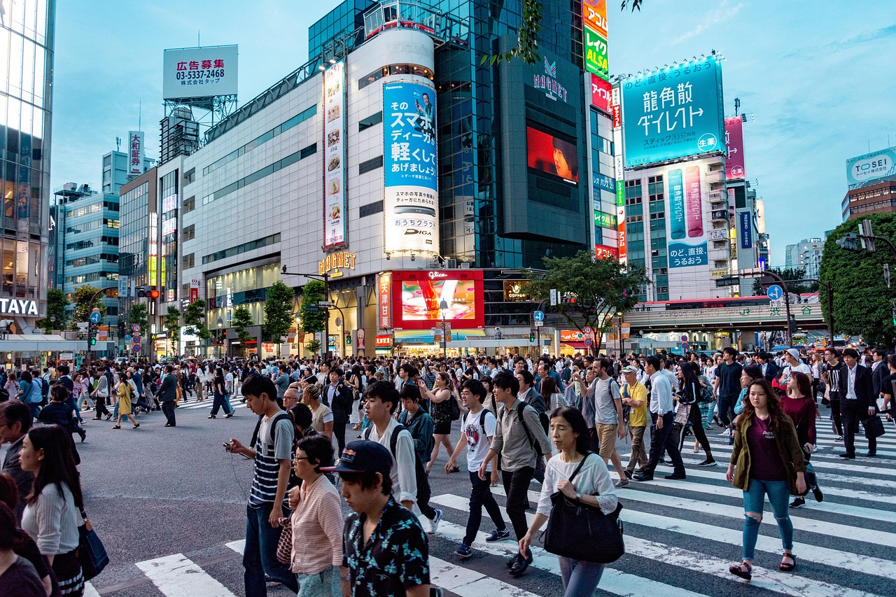
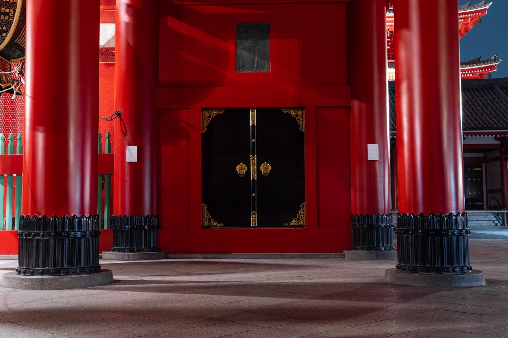
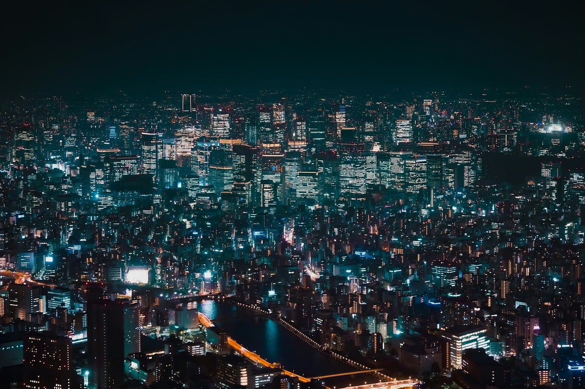

# 도쿄 3박 4일 일정 추천, 동선 짜기 쉬운 코스 총정리

도쿄는 처음 가면 어디부터 봐야 할지 막막한 도시입니다. 지하철 노선은 복잡하고, 가고 싶은 곳은 도시 곳곳에 흩어져 있기 때문입니다. 이 글에서는 **도쿄 3박 4일 일정**을 지역별로 묶어 이동 시간을 줄이는 코스로 정리했습니다. 첫 도쿄 여행이라면 이 순서를 기본 틀로 잡고, 취향에 맞게 바꿔 보세요.

## 도쿄 3박 4일 일정 짜기 전 기본 원칙

도쿄 일정을 짤 때 가장 중요한 원칙은 **하루에 한두 개 지역만 묶는 것**입니다. 도쿄는 생각보다 넓어서 아침에 동쪽 아사쿠사를 보고 저녁에 서쪽 시부야를 찍는 식으로 다니면 이동만으로 체력이 크게 줄어듭니다.

- 하루 핵심 일정은 2~3개로 제한하고 나머지는 여유를 둡니다.
- 인기 전망대나 전시관은 예약이 필요한 경우가 많아 미리 시간대를 정해 둡니다.
- 하루 걸음 수가 2만 보 안팎까지 나올 수 있으니 편한 신발은 필수입니다.

## 숙소와 교통, 이렇게 정하세요

숙소는 **신주쿠, 시부야, 우에노** 중 한 곳을 추천합니다. 세 지역 모두 야마노테선이 지나가 다른 지역으로 이동하기 쉽고, 공항 연결 열차도 잘 되어 있습니다. 신주쿠는 노선이 가장 다양하지만 역이 매우 복잡합니다. 우에노는 상대적으로 숙박비가 합리적이고 나리타 공항에서 접근성이 좋은 편입니다.

교통은 스이카(Suica)나 파스모(PASMO) 같은 IC카드를 쓰면 대부분 해결됩니다. 모바일 지갑에 등록해 쓰는 방법도 있으니 본인 휴대폰 기종에서 가능한지 출발 전에 확인해 보세요. 지하철 무제한 패스는 하루에 4~5번 이상 탈 때만 이득인 경우가 많아서, 이 글의 코스처럼 지역을 묶어 다니면 IC카드가 더 낫습니다.

## 1일차: 도착 후 아사쿠사·우에노 가볍게 시작

첫날은 공항에서 숙소로 이동하고 짐을 맡기면 오후가 됩니다. 무리하지 않고 **동쪽 지역**만 둘러보는 것이 좋습니다.

- **아사쿠사**: 센소지와 가미나리몬, 나카미세 거리를 천천히 걷습니다. 길거리 간식으로 멘치카츠나 닌교야키 같은 먹거리가 유명합니다.
- **스미다강 산책**: 아사쿠사에서 강변으로 나가면 도쿄 스카이트리가 보입니다. 전망대에 오르지 않아도 사진 포인트로 좋습니다.
- **우에노**: 저녁에는 우에노 아메요코 시장 주변에서 이자카야나 라멘으로 첫날을 마무리합니다.

*Image by [sofi5t](https://pixabay.com/users/sofi5t-6957643/) on [Pixabay](https://pixabay.com/photos/japan-travel-nature-asia-plant-4141578/)*

## 2일차: 시부야·하라주쿠·신주쿠 서쪽 핵심 코스

둘째 날은 도쿄다운 풍경을 가장 많이 볼 수 있는 **서쪽 지역**입니다. 야마노테선을 따라 이동하면 동선이 자연스럽습니다.

### 오전: 메이지 신궁과 하라주쿠

메이지 신궁은 도심 속 숲길로, 오전에 가면 한적하고 공기가 좋습니다. 이어서 다케시타 거리에서 크레이프나 디저트를 즐기고, 오모테산도 쪽으로 걸어 내려가며 카페나 편집숍을 구경합니다.

### 오후: 시부야

시부야 스크램블 교차로를 건너 보고, 쇼핑몰과 골목을 둘러봅니다. **시부야 스카이** 같은 전망 시설은 해 질 무렵 시간대가 인기가 높아 사전 예약을 권합니다. 노을에서 야경으로 넘어가는 시간을 노리면 한 번에 두 가지 풍경을 볼 수 있습니다.

### 저녁: 신주쿠

신주쿠로 넘어가 번화가를 걷습니다. 오모이데 요코초의 좁은 골목에서 꼬치구이를 먹거나, 가부키초의 네온사인 거리를 구경하는 것이 대표적인 코스입니다. 밤늦게까지 사람이 많으니 소지품 관리에 신경 쓰세요.

## 3일차: 취향에 따라 고르는 도요스·긴자·오다이바

셋째 날은 **도쿄 만 쪽 지역**으로 나갑니다. 한 곳을 길게 보고 싶은지, 쇼핑과 식사를 중심으로 할지에 따라 선택하세요.

- **디지털 아트 체험을 원한다면**: 도요스 지역의 팀랩 플래닛 같은 몰입형 전시를 추천합니다. 입장권은 시간 지정제인 경우가 많아 일정이 정해지면 먼저 예약하세요.
- **먹거리 중심이라면**: 쓰키지 장외시장에서 해산물 덮밥이나 계란말이 같은 간식을 먹어 보고, 긴자로 이동해 백화점 지하 식품관과 디저트 가게를 둘러봅니다.
- **여유로운 산책을 원한다면**: 오다이바 해변 공원에서 레인보우브리지 야경을 보는 코스가 무난합니다.

*Image by [binmassam](https://pixabay.com/users/binmassam-15041405/) on [Pixabay](https://pixabay.com/photos/temple-japan-senso-ji-worship-4807324/)*

마지막 밤에는 쇼핑 시간을 확보해 두는 것이 좋습니다. 돈키호테, 드럭스토어, 편의점 간식은 짧게 몰아서 사도 충분합니다. 면세 조건은 구매 금액과 품목에 따라 달라지므로 계산대에서 여권을 보여 주기 전에 확인하세요.

## 4일차: 체크아웃 후 근처에서 마무리

마지막 날은 비행기 시간에 맞춰 움직여야 하므로 **숙소 근처**에서만 일정을 잡습니다. 오전에 신주쿠 교엔이나 우에노 공원처럼 가까운 공원을 산책하거나, 역 근처 카페에서 느긋하게 브런치를 먹는 정도가 알맞습니다. 공항까지 이동 시간은 숙소 위치와 열차 종류에 따라 대략 1시간에서 1시간 30분 안팎이니 여유 있게 출발하세요. 공항 면세점이나 식당에서 마지막 쇼핑을 하는 것도 좋은 방법입니다.

*Image by [Michael_Pointner](https://pixabay.com/users/Michael_Pointner-28601164/) on [Pixabay](https://pixabay.com/photos/bridge-city-dark-japan-japanese-9620082/)*

## 자주 묻는 질문

### Q1. 도쿄 3박 4일이면 충분한가요?
핵심 명소를 처음 둘러보기에는 충분합니다. 다만 도착과 출발 시간 때문에 실제로 쓸 수 있는 시간은 이틀 반 정도입니다. 근교 여행까지 넣고 싶다면 4박 이상을 권합니다.

### Q2. 도쿄 3박 4일 여행 경비는 얼마나 드나요?
항공권과 숙소 등급에 따라 차이가 큽니다. 현지에서 쓰는 식비와 교통비, 입장료는 하루 대략 1만 엔 안팎으로 잡는 경우가 많습니다. 환율과 물가는 수시로 바뀌므로 출발 전에 다시 계산해 보세요.

### Q3. 일본어를 못 해도 괜찮을까요?
대부분의 역과 관광지에 영어와 한국어 안내가 있어 큰 불편은 없습니다. 식당에서는 번역 앱이나 사진 메뉴를 활용하면 됩니다. 구글 지도의 길찾기 기능은 환승 안내가 정확해 도쿄 지하철 이용에 큰 도움이 됩니다.

## 마무리

도쿄 3박 4일 일정은 **동쪽(아사쿠사·우에노) → 서쪽(하라주쿠·시부야·신주쿠) → 만 지역(도요스·긴자·오다이바) → 숙소 근처 마무리** 순서로 묶으면 이동이 훨씬 편해집니다. 욕심내서 많이 넣기보다 하루 두세 곳에 집중하고 식사 시간을 여유 있게 두는 것이 만족도를 높입니다.

가격, 운영 시간, 교통편, 예약 방식은 자주 바뀔 수 있습니다. 방문 전 최신 정보를 꼭 확인하세요.
