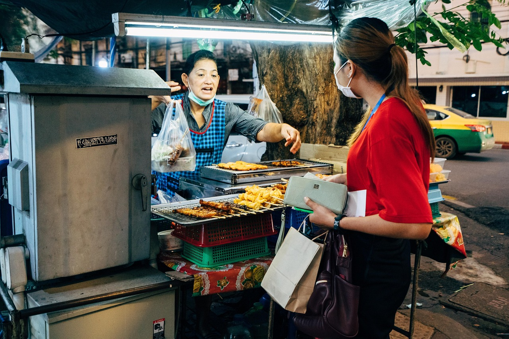
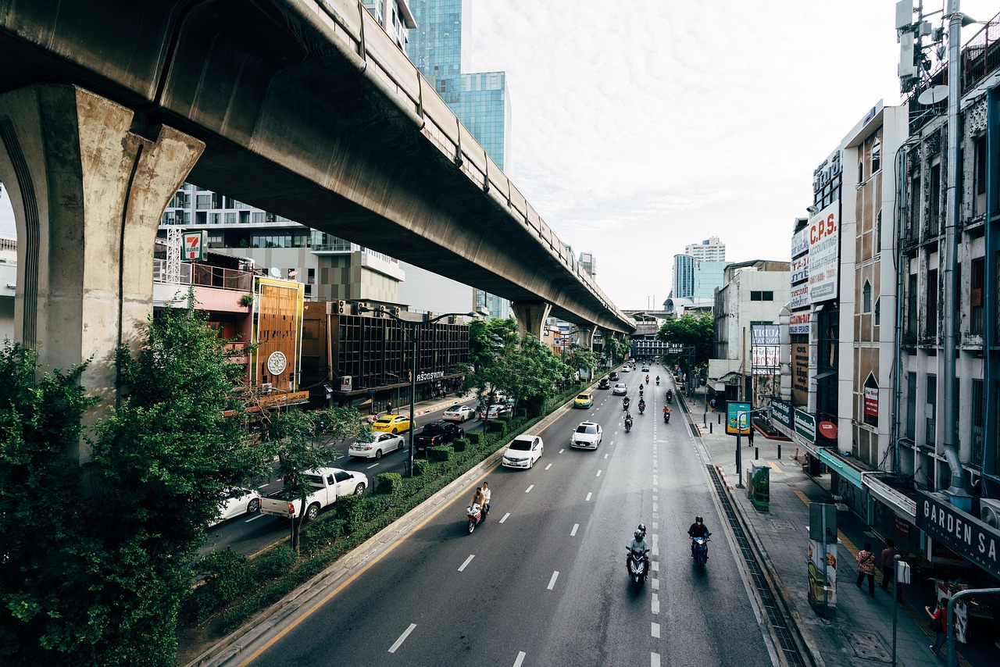
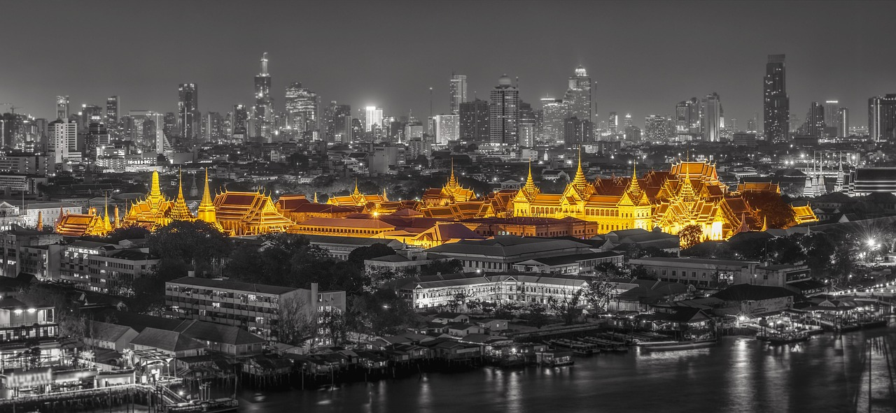

# 방콕 가성비 여행 팁: 숙소·교통·먹거리 아끼는 법

방콕은 비행시간이 짧고 물가도 비교적 부담이 적어서, 한 번쯤 가 보고 싶은 여행지로 꼽힙니다. 그래도 아무 계획 없이 가면 택시비, 카페, 쇼핑몰 식당에서 예상보다 지출이 빠르게 늘어납니다. 이 글에서는 **방콕 가성비 여행 팁**을 숙소, 교통, 먹거리, 관광, 환전·통신 순서로 정리했습니다. 읽고 나면 어디에서 아끼고 어디에 쓸지 기준이 잡히실 겁니다.

*Image by [viarami](https://pixabay.com/users/viarami-13458823/) on [Pixabay](https://pixabay.com/photos/thailand-street-vendor-street-food-7442285/)*

## 1. 숙소: 위치가 곧 비용이다

방콕에서는 숙소 가격만 보고 고르면 오히려 손해일 때가 많습니다. 교통비와 이동 시간이 같이 늘어나기 때문입니다.

### BTS·MRT 역 도보 10분 이내를 우선으로

- 도시 중심부는 BTS(스카이트레인)와 MRT(지하철)가 잘 연결되어 있습니다. 역에서 걸어서 갈 수 있는 숙소를 고르면 택시를 탈 일이 크게 줄어듭니다.
- 처음 가신다면 시암, 칫롬, 아속, 프롬퐁 주변이 이동하기 편한 편입니다. 이 지역은 대체로 가격대가 높은 편이라, 한두 정거장 떨어진 지역을 보면 더 저렴한 숙소를 찾을 수 있습니다.
- 카오산로드 주변은 숙박비가 저렴한 편이지만 지하철역이 가깝지 않습니다. 대신 왕궁, 왓포 같은 구시가지 관광은 걸어서 해결할 수 있어서, 이 일정이 중심이라면 좋은 선택입니다.

### 가성비 숙소를 고르는 요령

- 수영장이 있는 중급 호텔도 비수기에는 합리적인 가격에 나옵니다. 후기에서 방음, 에어컨 상태, 청결을 꼭 확인하세요.
- 4박 이상이라면 조식을 빼고 예약하세요. 주변 로컬 식당에서 먹는 것이 보통 더 저렴하고 선택지도 다양합니다.
- 11~2월은 날씨가 좋은 성수기라 가격이 오릅니다. 일정이 유연하다면 우기 직전이나 직후를 노려 보세요.

## 2. 교통: 대중교통 + 앱 택시 조합

방콕은 교통 체증이 심해서 택시가 항상 싼 선택은 아닙니다. 출퇴근 시간대에는 시간도 돈도 많이 듭니다.

### 시내 이동 기본 원칙

- **BTS·MRT**: 막히지 않고 에어컨이 있어 가장 효율적입니다. 이동 거리에 따라 요금이 달라지고, 대략 수십 바트 안팎입니다.
- **짜오프라야 수상버스**: 왓아룬, 왓포, 아이콘시암 쪽으로 갈 때 이동과 풍경 감상을 동시에 할 수 있습니다. 요금도 부담이 적은 편입니다.
- **Grab, Bolt 같은 호출 앱**: 가격을 미리 확인할 수 있어서 바가지 걱정이 적습니다. 비 오는 날이나 짐이 있을 때만 쓰면 효율적입니다.
- 길에서 택시를 잡을 때는 반드시 미터기 사용 여부를 확인하세요. 거부하면 다른 차를 타는 편이 낫습니다.

### 공항에서 시내로

- 수완나품 공항에서는 공항철도(ARL)가 시내 중심부로 가장 저렴하고 확실한 방법으로 알려져 있습니다. 목적지가 역 근처라면 이 방법이 편합니다.
- 짐이 많거나 늦은 밤 도착이라면 공식 택시 승강장이나 앱 호출을 이용하세요. 고속도로 통행료가 별도로 붙을 수 있다는 점도 기억해 두세요.

*Image by [viarami](https://pixabay.com/users/viarami-13458823/) on [Pixabay](https://pixabay.com/photos/road-asia-thailand-bangkok-7425079/)*

## 3. 먹거리: 한 끼 비싸게, 두 끼 현지식으로

방콕 가성비의 핵심은 음식입니다. 노점과 로컬 식당만 잘 활용해도 식비가 확 줄어듭니다.

### 로컬 음식으로 식비 줄이기

- **볶음 요리 한 접시 식사**: 팟타이, 카오팟(볶음밥), 팟끄라파오(바질 덮밥)는 부담 없는 가격으로 한 끼가 됩니다.
- **길거리 간식**: 무삥(돼지고기 꼬치), 과일 컵, 코코넛 아이스크림은 간단히 허기를 달래기 좋습니다.
- **야오와랏(차이나타운)**: 저녁에 노점이 많이 열려 해산물, 디저트, 국수류를 다양하게 맛볼 수 있습니다. 다만 해산물은 가격표를 먼저 확인하세요.
- **푸드코트**: 대형 쇼핑몰 지하나 상층에 있는 푸드코트는 에어컨이 있고 가격도 합리적입니다. 대부분 카드나 충전식 카드로 결제하는 방식이라 남은 금액은 환불을 받으세요.

### 이런 곳은 피하세요

- 관광지 바로 앞 식당은 메뉴판에 가격이 높게 책정된 경우가 많습니다. 두세 블록만 벗어나도 가격이 달라집니다.
- 생과일주스와 음료는 가게마다 차이가 큽니다. 주문 전에 가격을 확인하는 습관이 좋습니다.
- 카페는 하루 한 번으로 정하고, 나머지는 편의점 음료나 노점 음료로 대신하면 부담이 줄어듭니다.

## 4. 관광: 무료와 유료를 섞어서 계획하기

모든 명소를 입장료 내고 볼 필요는 없습니다. 방콕은 돈을 안 쓰고도 즐길 수 있는 곳이 많습니다.

- **사원**: 왓포, 왓아룬, 왕궁은 대표 명소이지만 입장료가 있고, 복장 규정이 엄격합니다. 어깨와 무릎을 가리는 옷을 챙기세요. 일정이 짧다면 한두 곳만 골라서 깊게 보는 편이 만족도가 높습니다.
- **공원과 야경**: 룸피니 공원은 무료로 산책할 수 있고, 시내 쇼핑몰과 루프톱 주변에서 야경을 볼 수 있습니다. 루프톱 바는 음료 최소 주문 금액이 있는 경우가 많으니 미리 확인하세요.
- **시장**: 주말에는 짜뚜짝 시장이 대표적입니다. 규모가 커서 시간이 많이 걸리니 편한 신발은 필수입니다. 야시장은 구경만 해도 재미있으니 쇼핑 예산을 먼저 정해 두세요.
- **마사지**: 관광지 인근 대형 업체보다 골목의 로컬 업체가 대체로 저렴하지만, 후기와 위생 상태를 꼭 확인하세요. 하루 한 번으로 횟수를 정해 두면 예산 관리가 쉽습니다.

*Image by [sasint](https://pixabay.com/users/sasint-3639875/) on [Pixabay](https://pixabay.com/photos/bangkok-ancient-architecture-1807480/)*

## 5. 환전·통신·결제: 작은 수수료까지 챙기기

- **환전**: 공항 환전소는 편하지만 환율이 불리한 경우가 많습니다. 최소 금액만 공항에서 바꾸고, 나머지는 시내 환전소나 트래블 카드 같은 외화 인출 방법을 비교해서 쓰세요.
- **ATM 수수료**: 태국 ATM은 인출할 때마다 외국 카드에 수수료가 붙는 것으로 알려져 있습니다. 소액을 자주 인출하기보다 필요한 만큼 한 번에 뽑는 것이 낫습니다.
- **현지 결제 통화**: 카드 결제 때 원화로 결제하겠느냐고 물으면 거절하고, 현지 통화(바트)로 결제하는 것이 보통 유리합니다.
- **유심·eSIM**: 일정에 맞는 데이터 요금제를 미리 비교하세요. 공항 매장보다 온라인 사전 구매가 저렴한 경우가 많습니다.

## 자주 묻는 질문(FAQ)

### Q1. 방콕 3박 5일 예산은 어느 정도 생각하면 되나요?
항공권과 숙소 등급에 따라 큰 차이가 납니다. 현지에서 쓰는 식비·교통비·입장료는 로컬 위주로 다니면 비교적 낮게 잡을 수 있고, 마사지와 쇼핑, 루프톱 같은 항목을 얼마나 넣느냐가 총액을 가릅니다. 하루 예산을 먼저 정한 뒤 항목별로 나누어 관리해 보세요.

### Q2. 방콕 여행은 언제가 가장 저렴한가요?
일반적으로 비가 잦은 우기(대략 6~10월)에 항공권과 숙소가 저렴한 편입니다. 대신 갑작스러운 소나기가 많아서 우산과 실내 일정 대안을 준비해야 합니다. 날씨가 가장 좋은 11~2월은 가격이 오릅니다.

### Q3. 방콕에서 택시 바가지를 피하는 방법이 있나요?
호출 앱을 쓰면 예상 요금을 미리 볼 수 있어 편합니다. 길에서 타신다면 미터기 사용을 확인하고, 거부하는 차량은 보내세요. 가능하면 BTS·MRT와 수상버스를 중심으로 동선을 짜는 것이 가장 확실한 방법입니다.

## 마무리

방콕 가성비 여행의 핵심은 세 가지입니다. 대중교통이 편한 곳에 숙소를 잡고, 식사는 로컬 위주로 하고, 입장료·마사지·카페 같은 변동 지출은 하루 기준을 정해 두는 것입니다. 이것만 지켜도 질을 낮추지 않고 예산을 아낄 수 있습니다.

※ 이 글의 가격, 운영시간, 교통 정보는 시기와 상황에 따라 달라질 수 있습니다. **방문 전 최신 정보를 꼭 확인하세요.**
