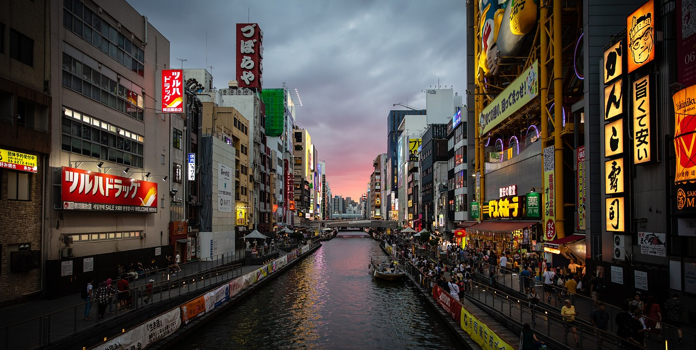
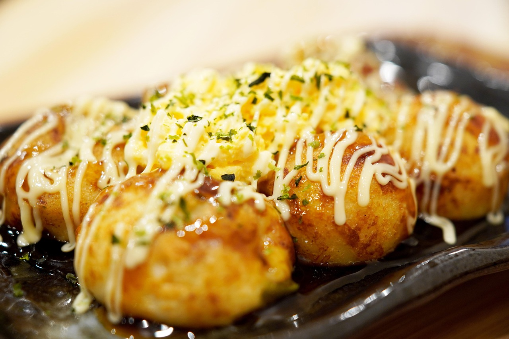
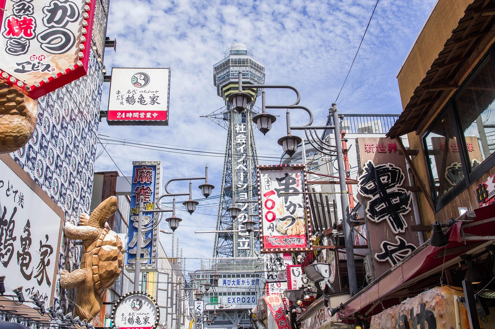

# 오사카 맛집 지도 대신 보는 구역별 먹거리 동선 가이드

오사카 여행을 준비하면 가장 먼저 검색하게 되는 것이 바로 **오사카 맛집 지도**입니다. 그런데 막상 지도 앱을 열면 핀이 너무 많아서 어디부터 가야 할지 막막해지기 쉽습니다. 이 글에서는 지도를 직접 보여드리는 대신, 오사카의 맛집이 몰려 있는 구역을 네 곳으로 나누고 각 구역에서 어떤 음식을 먹으면 좋은지, 어떤 순서로 걸으면 효율적인지를 정리했습니다. 이 순서대로 일정을 짜 두면 구글 지도에 저장할 때도 훨씬 수월합니다.

*Image by [gabyobs](https://pixabay.com/users/gabyobs-13938287/) on [Pixabay](https://pixabay.com/photos/japan-osaka-dotombori-evening-4549082/)*

## 오사카 맛집 지도, 구역별로 먼저 나눠 보세요

오사카는 도쿄처럼 땅이 넓지 않고, 주요 관광지가 지하철 몇 정거장 안에 모여 있습니다. 그래서 가게 이름부터 찾기보다 **구역을 먼저 정하고, 그 안에서 음식 종류를 고르는 방식**이 훨씬 효율적입니다.

- 남쪽 번화가: 난바·도톤보리 (타코야키, 오코노미야키, 규카츠)
- 북쪽 중심가: 우메다·기타 (점심 정식, 이자카야, 카페)
- 서민 동네: 신세카이·덴노지 (쿠시카츠)
- 로컬 감성: 덴마·나카자키초 (작은 식당, 카페)

숙소가 어느 구역에 있느냐에 따라 하루에 두 구역 정도만 묶어서 움직이면 충분합니다.

## 난바·도톤보리: 오사카 먹거리의 중심

오사카 맛집 지도를 열었을 때 핀이 가장 빽빽하게 찍히는 곳이 난바와 도톤보리 일대입니다. 글리코 간판이 보이는 도톤보리 강변을 중심으로 상점가와 골목이 이어져 있어, 처음 방문하는 여행자라면 하루 한 끼 정도는 이곳에서 해결하게 됩니다.

### 이 구역에서 먹어볼 음식

- **타코야키**: 겉은 바삭하고 속은 부드러운 오사카의 대표 길거리 음식입니다. 가게마다 소스와 토핑이 달라서 여러 곳을 조금씩 비교해 먹는 재미가 있습니다.
- **오코노미야키**: 철판 위에서 직접 구워 주는 가게가 많습니다. 양배추가 듬뿍 들어간 기본 메뉴부터 시작해 보세요.
- **규카츠, 라멘, 초밥**: 관광객이 많은 만큼 선택지가 다양하고, 외국어 메뉴를 갖춘 곳도 많습니다.

### 동선 팁

도톤보리는 저녁에 네온사인이 켜질 때 분위기가 가장 좋지만, 그만큼 줄도 깁니다. 식사 시간대를 살짝 비껴 오후 2~4시 무렵이나 오픈 직후에 방문하면 대기 시간을 많이 줄일 수 있습니다. 식사를 마친 뒤에는 강변을 따라 걸으며 소화를 시키고, 근처 상점가에서 디저트로 마무리하는 코스를 추천합니다.

*Image by [takedahrs](https://pixabay.com/users/takedahrs-12657/) on [Pixabay](https://pixabay.com/photos/takoyaki-gourmet-food-meal-5143845/)*

## 우메다·기타: 점심 정식과 이자카야를 한 번에

오사카역과 우메다역 주변은 백화점과 지하상가, 고층 빌딩이 모여 있는 도시형 구역입니다. 관광객 중심의 도톤보리와는 달리 **직장인을 위한 점심 정식 식당과 이자카야**가 많아서, 차분하게 식사하고 싶을 때 좋습니다.

- 점심: 정식, 튀김, 덮밥 등을 합리적인 가격대로 파는 식당이 많습니다. 대략 1,000엔 안팎의 점심 세트를 내놓는 곳도 흔하지만, 가격은 가게마다 다르니 참고만 하세요.
- 저녁: 고가도로 아래나 빌딩 지하의 이자카야 골목에서 가볍게 한잔하기 좋습니다.
- 백화점 지하 식품관(데파치카)에서는 도시락과 디저트를 사서 숙소에서 먹는 방법도 있습니다.

우메다는 지하도가 복잡하기 때문에, 지도 앱에서 출구 번호까지 확인하고 이동하는 것이 좋습니다.

## 신세카이·덴노지: 쿠시카츠 골목 탐방

츠텐카쿠 타워 아래로 펼쳐지는 신세카이는 오사카의 옛 정취가 남아 있는 지역입니다. 이곳의 대표 음식은 단연 **쿠시카츠(꼬치튀김)** 입니다. 소고기, 새우, 야채, 치즈 등 다양한 꼬치를 튀겨 소스에 찍어 먹는데, 한 개당 가격이 부담스럽지 않아 여러 종류를 시도해 보기 좋습니다.

주의할 점은 오사카 쿠시카츠의 대표 규칙인 **소스 두 번 담그기 금지**입니다. 공용 소스 용기에 한 번 찍은 꼬치를 다시 담그지 않아야 하며, 소스가 모자라면 함께 나오는 양배추로 떠서 뿌려 먹습니다. 가게 안내문을 한 번 확인하는 습관을 들이세요.

덴노지 공원이나 동물원, 미술관과 묶으면 낮에는 관광, 저녁에는 쿠시카츠로 이어지는 일정이 자연스럽게 완성됩니다. 해가 진 뒤에는 골목이 다소 번잡할 수 있으니 소지품을 잘 챙기세요.

*Image by [jackmac34](https://pixabay.com/users/jackmac34-483877/) on [Pixabay](https://pixabay.com/photos/tower-landmark-shops-structure-5719067/)*

## 덴마·나카자키초: 현지 분위기의 작은 식당들

번화가의 인파가 부담스럽다면 덴마와 나카자키초 쪽으로 방향을 돌려 보세요. 덴마 일대는 현지인이 즐겨 찾는 선술집과 작은 식당이 많고, 나카자키초는 오래된 주택을 개조한 카페와 소규모 가게가 골목마다 자리하고 있습니다.

- 덴마: 서서 마시는 술집, 꼬치구이, 오뎅 등 현지인 중심의 저녁 코스
- 나카자키초: 브런치, 커피, 디저트 중심의 느긋한 오후 코스

이 지역은 가게마다 영업일과 시간이 불규칙한 경우가 많아서, 방문 직전에 SNS나 지도 앱의 최근 리뷰를 확인하는 것이 안전합니다.

## 실패 확률을 줄이는 맛집 고르기 요령

1. **지도 앱 저장 목록을 구역별로 분류**하세요. 폴더를 난바, 우메다, 신세카이처럼 나누면 현장에서 가까운 곳을 바로 찾을 수 있습니다.
2. **평점과 리뷰 수를 함께 확인**하세요. 평점이 높아도 리뷰가 적으면 편차가 있을 수 있습니다.
3. **현금과 카드 사용 여부를 확인**하세요. 소규모 가게는 현금만 받는 곳이 아직 있습니다.
4. **인기 식당은 예약**을 고려하세요. 온라인 예약이 가능한 가게도 있고, 호텔 컨시어지에 부탁할 수도 있습니다.
5. **한 끼에 한 가지 메뉴만 욕심내지 않기**: 오사카는 조금씩 여러 가지를 먹는 재미가 큰 도시입니다.

## 자주 묻는 질문

### Q1. 오사카 맛집 지도는 어떤 앱으로 만드는 게 좋나요?
구글 지도의 저장 목록 기능이 가장 무난합니다. 구역별로 목록을 나누고 아이콘을 다르게 지정해 두면 일정 짤 때 편리합니다. 일본 현지 맛집 평가 사이트의 정보를 함께 참고하면 더 정확합니다.

### Q2. 오사카 2박 3일이면 맛집은 몇 곳 정도 가능한가요?
하루 세 끼에 간식을 포함하면 대략 8~10곳 정도가 현실적입니다. 다만 이동과 대기 시간을 고려해 핵심 4~5곳만 정하고 나머지는 즉흥적으로 고르는 것을 추천합니다.

### Q3. 혼자 여행해도 식사하기 편한가요?
네, 오사카는 카운터석 위주의 식당과 서서 먹는 가게가 많아 혼자서도 부담이 적습니다. 다만 철판 요리나 불판 요리는 2인 이상 주문을 권하는 곳이 있으니 메뉴를 먼저 확인해 보세요.

## 마무리

오사카 맛집 지도는 핀을 많이 찍는 것보다 **구역과 음식 종류를 먼저 정리하는 것**이 핵심입니다. 난바·도톤보리에서 대표 길거리 음식을, 우메다에서 차분한 정식을, 신세카이에서 쿠시카츠를, 덴마와 나카자키초에서 로컬 분위기를 즐겨 보세요. 하루에 한두 구역만 묶어도 알찬 미식 여행이 됩니다.

※ 본문의 가격, 영업시간, 교통 정보는 시기에 따라 달라질 수 있습니다. 방문 전 최신 정보를 꼭 확인하세요.
